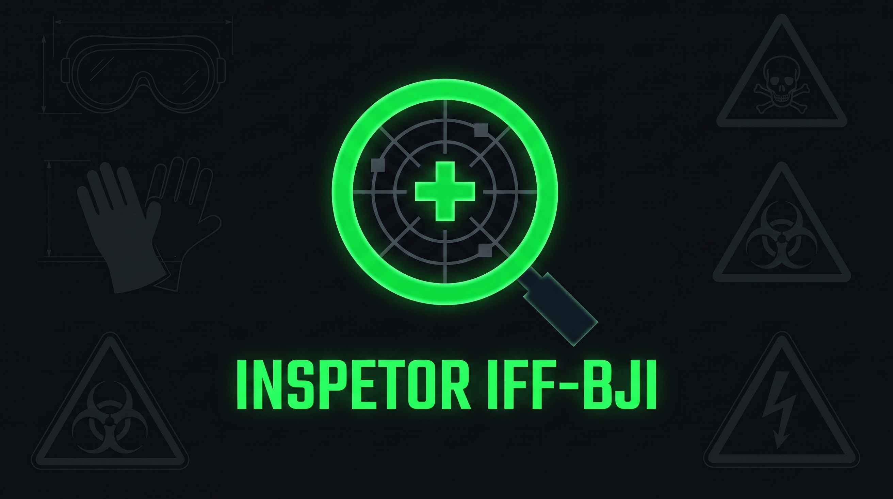
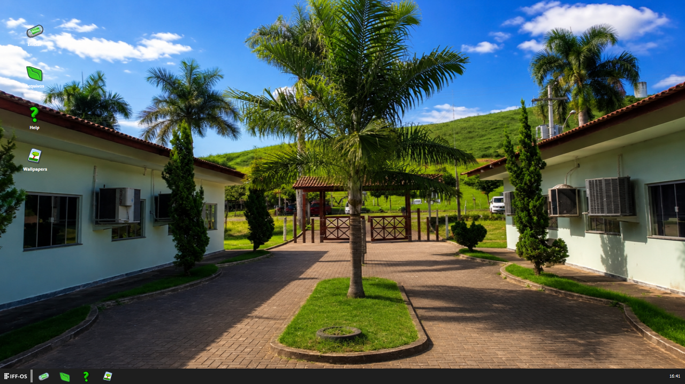
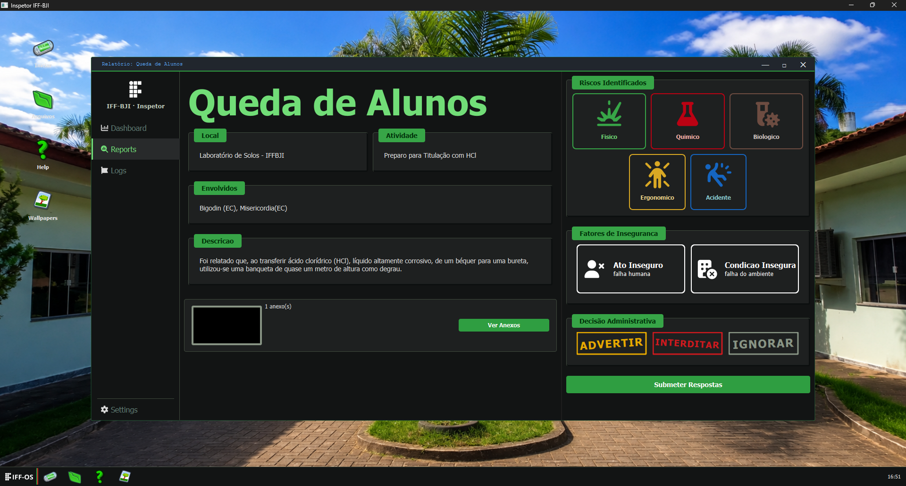
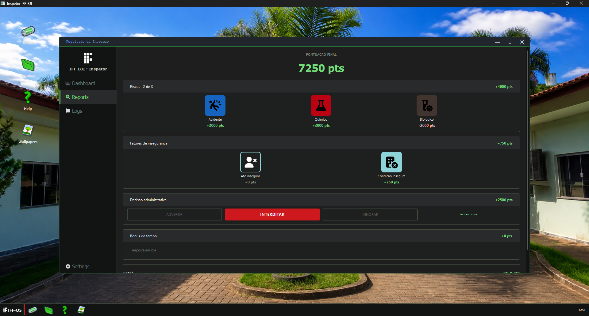

<p align="center">
  
</p>

# Inspetor IFF-BJI

[](https://www.python.org/downloads/)
[](LICENSE)
[](https://github.com/WelingtonPeres/Inspetor_IFF_BJI/releases)

## Apresentação

**Inspetor IFF-BJI** é um simulador educacional para análise de risco ocupacional, desenvolvido como atividade de Curricularização da Extensão no Instituto Federal Fluminense (IFF), Campus Bom Jesus do Itabapoana, na disciplina de Higiene e Segurança do Trabalho.

O simulador é um **ambiente de prática** em que o jogador assume o papel de inspetor: analisa relatórios de ocorrências registradas em vídeo no Laboratório de Solos do campus, identifica os riscos ocupacionais (NR-26), classifica os fatores de insegurança (ato inseguro e condição insegura) e escolhe a decisão administrativa adequada (advertir, interditar ou ignorar).

A avaliação ocorre sob pressão de tempo, com retorno imediato e uma pontuação determinística que premia **exatidão** (acertos nas classificações), **completude** (cobertura de todos os riscos) e **eficiência** (a nota decai quando o tempo ideal é ultrapassado).

---

## 🎨 Interface e Gameplay

A interface simula o desktop de um sistema operacional ("IFF-OS"): área de trabalho com atalhos, barra de tarefas e janelas que podem ser maximizadas, minimizadas e fechadas. Ao iniciar um novo jogo, um tutorial de 8 slides apresenta as mecânicas.

### 1. Seleção de Perfil



Escolha o perfil do inspetor em um carrossel com **9 opções**: um perfil padrão e um para cada curso do campus (por exemplo, "T. Meio Ambiente").

**Elementos visíveis:**
- Carrossel com o cartão ilustrado de cada perfil
- Indicador de posição (ex.: 6/9)
- Botão "Confirmar" para iniciar o expediente

### 2. Tela de Inspeção — Relatório e Decisão



Analise o **relatório**:
- **Local**: onde ocorreu o fato (ex.: "Laboratório de Solos - IFFBJI")
- **Atividade**: o que estava sendo feito (ex.: "Preparo para Titulação com HCl")
- **Envolvidos**: pessoas presentes
- **Descrição**: narrativa do cenário
- **Anexos**: vídeo da ocorrência, que pode ser ampliado

**Identifique os riscos:**
- 5 categorias, cada uma com sua cor: Físico (verde), Químico (vermelho), Biológico (marrom), Ergonômico (amarelo) e Acidente (azul)
- Clique para marcar os riscos encontrados

**Classifique os fatores de insegurança:**
- Ato Inseguro (falha humana)
- Condição Insegura (falha do ambiente ou do equipamento)

**Escolha a decisão administrativa:**
- ADVERTIR — para riscos que pedem orientação e correção
- INTERDITAR — para riscos graves, que exigem parar a atividade
- IGNORAR — quando não há risco que justifique ação

O botão **"Submeter Respostas"** envia a análise.

### 3. Tela de Resultado — Diagnóstico e Pontuação



Receba **retorno imediato e detalhado**. No exemplo acima, a pontuação final de 7250 pts se decompõe em:
- **Riscos** (2 de 3): +4000 pts — dois acertos de +3000 pts e um risco marcado indevidamente, de −2000 pts
- **Fatores de insegurança**: +750 pts
- **Decisão administrativa**: +2500 pts (decisão ótima)
- **Bônus de tempo**: +0 pts (resposta em 25 s, dentro do tempo ideal)

Cada risco e cada fator aparece com a sua contribuição individual, e a decisão correta é destacada quando o jogador escolhe outra. Ao fim do expediente, a tela de vitória ou de derrota traz um parecer da CIPA sobre o desempenho.

---

## 📋 Sumário

- [✨ Características Distintivas](#-características-distintivas)
- [🎮 Fluxo de Operação](#-fluxo-de-operação)
- [🚀 Instalação Rápida](#-instalação-rápida)
- [📚 Documentação](#-documentação)
- [🏗️ Arquitetura de Software](#️-arquitetura-de-software)
- [📄 Licença](#-licença)
- [👥 Contribuidores](#-contribuidores)
- [📊 Status do Projeto](#-status-do-projeto)
- [🎓 Contexto Institucional e Académico](#-contexto-institucional-e-académico)

---

## ✨ Características Distintivas

- **Modelo de avaliação determinístico** — Equação de pontuação explícita que premia exatidão, completude e eficiência temporal. A mesma resposta, no mesmo tempo, produz sempre a mesma nota.

- **Cenários do próprio campus** — 12 ocorrências gravadas em vídeo no Laboratório de Solos do IFF-BJI, com relatórios, equipamentos e contextos que os estudantes reconhecem.

- **Classificação normativa de riscos** — Cinco categorias segundo a NR-26: Físico, Químico, Biológico, Ergonômico e Acidente, cada uma com sua cor.

- **Decisões administrativas com peso** — Três ações (Advertir, Interditar, Ignorar): a decisão ótima vale 25% da nota do cenário, a alternativa aceitável vale 12,5% e a incorreta não pontua.

- **Pressão de tempo** — Até 45 segundos, a nota é integral; depois disso decai linearmente, até o piso de 50%.

- **Retorno formativo** — Após cada relatório, diagnóstico item a item: riscos e fatores acertados, esquecidos e marcados indevidamente, com a pontuação de cada um.

- **Tutorial integrado** — 8 slides interativos explicam mecânicas, termos e fluxo; podem ser consultados a qualquer momento pelo atalho "Help".

- **Interface responsiva** — Dimensionamento automático para diferentes resoluções (a partir de 1280×720) e temas escuro e claro.

- **Arquitetura em camadas** — Clean Architecture (Core, Infrastructure, Application, View) com separação de responsabilidades e 615 testes automatizados.

---

## 🎮 Fluxo de Operação

1. **Tutorial**: ao clicar em iniciar, o tutorial de 8 slides é exibido.

2. **Escolha de Perfil**: seleção de um dos 9 perfis. Nesta versão, todos os perfis recebem o mesmo conjunto de cenários; a separação de cenários por curso já é suportada pelo formato de dados e será usada quando houver cenários específicos.

3. **Apresentação do Caso**: relatório com local, atividade, envolvidos e descrição, acompanhado do vídeo da ocorrência.

4. **Identificação de Riscos**: marcação dos riscos observados entre as cinco categorias. O objetivo é cobrir todos os riscos presentes sem marcar riscos inexistentes.

5. **Classificação de Insegurança**: **Ato Inseguro** (comportamento inadequado) e/ou **Condição Insegura** (ambiente ou equipamento inadequado).

6. **Decisão Administrativa**: escolha de uma única ação — **Advertir**, **Interditar** ou **Ignorar**.

7. **Cálculo e Diagnóstico**: o sistema calcula a pontuação e apresenta a análise item a item.

8. **Fim do Expediente**: o expediente é aprovado quando a pontuação atinge **60% do máximo possível**. Nesta versão, cada expediente sorteia um dos 12 cenários; "Jogar novamente" inicia outro expediente com novo sorteio.

As fórmulas completas estão em [Modelagem Matemática](docs/game-design/modelagem-matematica.md).

---

## 🚀 Instalação Rápida

**Pré-requisitos:** Python 3.11+

### Opção 1: Via Git (recomendado para desenvolvimento)

**1. Clone o repositório:**

```bash
git clone https://github.com/WelingtonPeres/Inspetor_IFF_BJI.git
cd Inspetor_IFF_BJI
```

**2. Crie o ambiente virtual** (isolamento das dependências do sistema):

```bash
python -m venv venv
```

**3. Ative o ambiente virtual** — o comando muda conforme o sistema:

| Sistema | Comando |
|---|---|
| Windows (PowerShell) | `.\venv\Scripts\Activate.ps1` |
| Windows (Prompt de Comando) | `.\venv\Scripts\activate.bat` |
| Linux/macOS | `source venv/bin/activate` |

Depois de ativar, o terminal passa a exibir `(venv)` no início da linha.

**4. Instale as dependências:**

```bash
pip install -r requirements.txt
```

**5. Inicie o jogo:**

```bash
python main.py
```

### Opção 2: Download do ZIP (sem Git)

1. Baixe o código-fonte da versão mais recente em [Releases](https://github.com/WelingtonPeres/Inspetor_IFF_BJI/releases), ou clique no botão **Code** > **Download ZIP**
2. Extraia o arquivo em uma pasta de sua escolha
3. Abra o terminal/PowerShell na pasta extraída
4. Execute:

```bash
python -m venv venv
# Windows (PowerShell): .\venv\Scripts\Activate.ps1
# Linux/macOS:          source venv/bin/activate
pip install -r requirements.txt
python main.py
```

### Tema claro

O jogo abre no tema escuro. Para usar o tema claro, defina a variável de ambiente `APP_THEME` antes de iniciar:

```bash
# Linux/macOS
APP_THEME=light python main.py
# Windows (PowerShell)
$env:APP_THEME="light"; python main.py
```

### Executando os testes

```bash
pytest
```

**Dúvidas?** Consulte o [Guia de Contribuição](CONTRIBUTING.md) para detalhes de ambiente e de fluxo de trabalho.

---

## 📚 Documentação

Toda a documentação técnica vive em [`docs/`](docs/README.md), organizada por tema:

| Pergunta | Link |
|----------|------|
| **Como contribuo?** | [Guia de Contribuição](CONTRIBUTING.md) |
| **Como o código é organizado?** | [Clean Architecture](docs/arquitetura/clean-architecture.md), [Arquitetura da Camada View](docs/arquitetura/view.md), [Diagrama de Classes](docs/arquitetura/diagrama-classes.md) |
| **Como o jogo funciona?** | [Modelagem Matemática](docs/game-design/modelagem-matematica.md), [Level Design](docs/game-design/level-design.md) |
| **Qual é o schema dos dados?** | [Estrutura JSON](docs/dados/estrutura-json.md) |
| **Qual é o padrão de código?** | [Nomenclatura e PEP-8](docs/processo/nomenclatura-pep8.md) |
| **Quer revisar PRs?** | [Checklist de Code Review](docs/arquitetura/checklist-revisao.md) |

**Índice completo**: [docs/README.md](docs/README.md)

---

## 🏗️ Arquitetura de Software

O projeto implementa **Arquitetura Limpa** (Clean Architecture, Robert C. Martin), organizando o código em **camadas concêntricas** com dependências unidirecionais (sempre para dentro):

| Camada | Diretório | Responsabilidade | Dependências |
|--------|-----------|------------------|--------------|
| **Core (Domain)** | `core/model/`, `core/services/`, `core/dtos/`, `core/interfaces/` | Entidades, regras de negócio, algoritmos de cálculo (p.ex., equação de pontuação) | Nenhuma outra camada |
| **Infrastructure** | `infrastructure/` | Repositórios de leitura de JSON e fábrica de relatórios | Core apenas |
| **Application** | `application/controllers/`, `application/interfaces/` | Orquestração de casos de uso (`GameManager`, `GerenciadorDeTurno`) e contrato `IGameView` | Core + Infrastructure |
| **View** | `view/` | Interface com o usuário (PySide6/Qt), widgets, estilos e sinais | Contrato da Application e DTOs do Core |
| **Config** | `config/` | Constantes (caminho dos dados, cursos, tema padrão) e logging | Nenhuma |

**Propriedades:**
- **Alta coesão**: Cada camada tem uma única razão para mudar
- **Baixo acoplamento**: Dependências apontam para dentro; camadas internas não conhecem as externas
- **Testabilidade**: Core e Application são testados sem Qt; a view é substituída por um mock do contrato
- **Manutenibilidade**: Mudanças na UI não afetam cálculos de negócio

**Leitura completa**: [Clean Architecture](docs/arquitetura/clean-architecture.md), [Diagrama de Classes](docs/arquitetura/diagrama-classes.md), [Padrões da View](docs/arquitetura/view.md)

---

## 📄 Licença

Este projeto está licenciado sob a **Creative Commons Attribution-NonCommercial-ShareAlike 4.0 International License** (CC BY-NC-SA 4.0).

**O que você pode fazer:**
- ✓ Usar, copiar e redistribuir
- ✓ Remixar, transformar e melhorar
- ✓ Usar em contextos educacionais

**Com a condição de:**
- Atribuir crédito ao IFF e aos autores
- Não usar para fins comerciais
- Compartilhar derivados sob a mesma licença

Para o texto legal completo, veja [LICENSE](LICENSE).

---

## 👥 Contribuidores

### Autores

- Bernardo Pimentel de Alvarenga Proveti Moreira
- Letícia de Oliveira Marssola
- Luciano da Silva Matos
- Mateus Pimentel dos Santos
- Pedro Paulo de Souza Rodrigues
- Welington Peres Léo

**Orientação:** Prof. Rafael Artur de Paiva Gardoni

Contatos, instituição e demais créditos estão em [AUTHORS.md](AUTHORS.md).

### Como Contribuir

O projeto está em **desenvolvimento ativo** e aceita contribuições! 

1. Leia [CONTRIBUTING.md](CONTRIBUTING.md) para diretrizes
2. Abra uma [Issue](https://github.com/WelingtonPeres/Inspetor_IFF_BJI/issues) para reportar bugs ou propor features
3. Envie um [Pull Request](https://github.com/WelingtonPeres/Inspetor_IFF_BJI/pulls) com suas melhorias
4. Siga os [padrões de código](docs/processo/nomenclatura-pep8.md) do projeto

---

## 📊 Status do Projeto

| Aspecto | Status |
|---------|--------|
| **Versão** | 🟢 1.0 |
| **Desenvolvimento** | 🟢 Ativo — novas features e melhorias contínuas |
| **Conteúdo** | 🟡 12 cenários (Laboratório de Solos); cenários por curso em elaboração |
| **Testes** | 🟢 615 testes automatizados (pytest e pytest-qt) |
| **Documentação** | 🟢 Revisada na versão 1.0 |
| **Licença** | 🟢 CC BY-NC-SA 4.0 |

---

## 🎓 Contexto Institucional e Académico

### Origem

Inspetor IFF-BJI é desenvolvido no **Instituto Federal Fluminense (IFF)**, Campus Bom Jesus do Itabapoana, como **Atividade de Curricularização da Extensão** — iniciativa que integra pesquisa, ensino e extensão conforme diretrizes institucionais.

**Curso:** Engenharia de Computação  
**Disciplina-sede:** Higiene e Segurança do Trabalho  
**Professor orientador:** Rafael Artur de Paiva Gardoni  
**Objetivo pedagógico:** Criar ambiente prático, seguro e repetível para que aprendizes internalizem critérios de análise de risco ocupacional — competência essencial para profissionais de segurança do trabalho.

### Justificativa Educacional

A análise de risco é uma atividade cognitiva complexa que exige integração de conhecimentos técnicos, normativos (NRs) e de tomada de decisão. O simulador oferece:

- **Prática sem riscos**: Estudantes enfrentam cenários reais sem colocar-se em risco
- **Feedback imediato**: Aprendem consequências de suas decisões instantaneamente
- **Escala de dificuldade**: Cenários classificados em cinco níveis, do introdutório ao especialista
- **Acesso democrático**: Ferramenta aberta (CC BY-NC-SA), reutilizável por outros IFs e instituições de ensino profissional

### Referência

> BRASIL. Lei nº 11.788, de 25 de setembro de 2008. Dispõe sobre o estágio de estudantes; altera a redação do art. 428 da Consolidação das Leis do Trabalho (CLT) [...]. Diário Oficial da União, Brasília, 2008.

Legislação sobre prática profissional; este projeto permite prática simulada.

---

**Última atualização:** Novembro de 2026  
**Instituição:** Instituto Federal Fluminense, Campus Bom Jesus do Itabapoana  
**Curso:** Engenharia de Computação  
**Orientador:** Prof. Rafael Artur de Paiva Gardoni  
**Créditos:** Veja [AUTHORS.md](AUTHORS.md)
