# Diagrama de Classes — Core, Infrastructure e Application

Visão de classes das camadas internas do projeto. A camada view, por ser extensa,
é documentada em [view.md](view.md); aqui ela aparece apenas como `JanelaPrincipal`,
a implementação do contrato `IGameView`.

```mermaid
classDiagram
    %% ==================== Core: Entidades ====================
    class Anexo {
        <<abstract>>
        -__id_anexo: int
        -__caminho_arquivo: str
        +id_anexo() int
        +caminho_arquivo() str
        +get_tipo_midia()* str
        +extrair_dados() dict
    }
    class AnexoImagem {
        +get_tipo_midia() str
    }
    class AnexoVideo {
        +get_tipo_midia() str
    }
    class AnexoAudio {
        +get_tipo_midia() str
    }
    class FolhaDeInspecao {
        <<abstract>>
        +LISTA_RISCOS_VALIDOS: List[str]
        +FATORES_INSEGURANCA_VALIDOS: List[str]
        -__riscos: List[str]
        -__fatores_inseguranca: List[str]
        +riscos() List[str]
        +fatores_inseguranca() List[str]
        +contar_riscos() int
        +contar_fatores() int
    }
    class FolhaDeGabarito {
        +LISTA_DECISOES_VALIDAS: List[str]
        -__decisao_otima: str
        -__decisao_boa: str
        +decisao_otima() str
        +decisao_boa() str
    }
    class FolhaDeResposta {
        +LISTA_DECISOES_VALIDAS: List[str]
        -__decisao_tomada: str
        -__tempo_gasto_segundos: int
        +decisao_tomada() str
        +tempo_gasto_segundos() int
    }
    class Relatorio {
        -__id_cenario: int
        -__titulo: str
        -__atividade: str
        -__local: str
        -__texto_descricao: str
        -__envolvidos: List[str]
        -__cursos: List[str]
        -__dificuldade: int
        -__anexos: List[Anexo]
        -__folha_gabarito: FolhaDeGabarito
        -__folha_resposta: FolhaDeResposta
        +id_cenario() int
        +titulo() str
        +atividade() str
        +local() str
        +texto_descricao() str
        +envolvidos() List[str]
        +dificuldade() int
        +cursos() List[str]
        +folha_gabarito() FolhaDeGabarito
        +folha_resposta_jogador() FolhaDeResposta
        +extrair_apresentacao_relatorio() dict
        +obter_anexos() List[Anexo]
        +adicionar_anexo(anexo) void
        +possui_anexos() bool
        +anexar_resposta_jogador(resposta) void
    }
    AnexoImagem --|> Anexo
    AnexoVideo --|> Anexo
    AnexoAudio --|> Anexo
    FolhaDeGabarito --|> FolhaDeInspecao
    FolhaDeResposta --|> FolhaDeInspecao
    Relatorio *-- Anexo
    Relatorio *-- FolhaDeGabarito
    Relatorio o-- FolhaDeResposta

    %% ==================== Core: Serviços ====================
    class MotorDePontuacao {
        +TAXA_DECAIMENTO_ALFA: float
        +LIMITE_MINIMO_RETENCAO: float
        +PESO_RISCOS: float
        +PESO_FATORES: float
        +PESO_DECISAO_OTIMA: float
        +PESO_DECISAO_BOA: float
        +TEMPO_IDEAL_SEGUNDOS: int
        +LIMIAR_VITORIA_TURNO: float
        +calcular_vmax_relatorio(relatorio) float
        +calcular_meta_turno(relatorios) float
        +calcular_pontuacao_relatorio(v_max, dto) float
        +calcular_pontuacao_detalhada(v_max, dto, feedback) DiagnosticoPontuacaoDTO
        +calcular_scores_por_item(v_max, feedback) tuple
        +conferir_condicao_vitoria(nota, v_max) bool
        -_calcular_pontuacao_riscos(...) float
        -_calcular_pontuacao_inseguranca(...) float
        -_calcular_pontuacao_decisao(...) float
        -_calcular_fator_tempo(tempo) float
    }
    class DiagnosticoDeResposta {
        +gerar_diagnostico_pontuacao(gabarito, respostas) DiagnosticoPontuacaoDTO
        +gerar_feedback(gabarito, respostas) DiagnosticoFeedbackDTO
    }
    MotorDePontuacao ..> DiagnosticoPontuacaoDTO : consome e produz
    MotorDePontuacao ..> DiagnosticoFeedbackDTO : consome
    MotorDePontuacao ..> Relatorio : lê
    DiagnosticoDeResposta ..> DiagnosticoPontuacaoDTO : cria
    DiagnosticoDeResposta ..> DiagnosticoFeedbackDTO : cria
    DiagnosticoDeResposta --> FolhaDeGabarito : usa
    DiagnosticoDeResposta --> FolhaDeResposta : usa

    %% ==================== Core: DTOs ====================
    class DiagnosticoPontuacaoDTO {
        <<dataclass frozen>>
        qnt_riscos_marcados: int
        qnt_riscos_gabarito: int
        qnt_riscos_corretos_marcados: int
        estado_ato: bool
        estado_condicao: bool
        status_decisao_jogador: str
        tempo_resposta_segundos: float
        pontuacao_final: float
        nota_riscos: float
        nota_fatores: float
        nota_decisao: float
        pontos_bonus_tempo: float
        qnt_fatores_gabarito: int
        qnt_fatores_marcados: int
        decisao_anulada: bool
    }
    class DiagnosticoFeedbackDTO {
        <<dataclass frozen>>
        riscos_acertados: list[str]
        riscos_esquecidos: list[str]
        riscos_inventados: list[str]
        fatores_acertados: list[str]
        fatores_esquecidos: list[str]
        fatores_inventados: list[str]
        decisao_tomada: str
        decisao_esperada: str
        score_por_risco: dict[str, float]
        score_por_fator: dict[str, float]
    }
    class ResultadoDiagnosticoDTO {
        <<dataclass frozen>>
        pontuacao: DiagnosticoPontuacaoDTO
        feedback: DiagnosticoFeedbackDTO
    }
    class ParecerCIPA {
        <<dataclass frozen>>
        numero: str
        referencia: str
        texto: str
    }
    ResultadoDiagnosticoDTO *-- DiagnosticoPontuacaoDTO
    ResultadoDiagnosticoDTO *-- DiagnosticoFeedbackDTO

    %% ==================== Core: Portas ====================
    class IPareceresCIPA {
        <<interface>>
        +obter_parecer_para_curso(curso)* ParecerCIPA
    }
    IPareceresCIPA ..> ParecerCIPA : devolve

    %% ==================== Infrastructure ====================
    class RepositorioJSON {
        +CURSOS_VALIDOS: List[str]
        +JSON_SCHEMA: dict
        -__diretorio_base: Path
        +curso_selecionado: str
        +quantidade_gerada: int
        +extrair_dados() List[DadosCenarioDTO]
        -__verificar_quantidade_gerada_valida() void
        -__verificar_curso_valido() void
        -__verificar_diretorio_existe() void
        -__validar_esquema_basico(dados) void
        -__traduzir_erro_validacao(...) void
    }
    class RepositorioDePareceresCIPA {
        -__caminho: Path
        -__pareceres_por_curso: Dict
        +obter_parecer_para_curso(curso) ParecerCIPA
        +cursos_disponiveis() List[str]
        -__carregar_pareceres() Dict
        -__gerar_numero() str
    }
    class RepositorioDePareceresCIPAVitoria
    class ParecerCIPAIndisponivelError {
        <<exception>>
    }
    class FabricaDeRelatorios {
        +construir_pilha(dados)$ List[Relatorio]
        -__instanciar_relatorio_unico(dto)$ Relatorio
        -__extrair_instanciar_anexos(dados)$ List[Anexo]
    }
    class DadosCenarioDTO {
        <<dataclass>>
        id_cenario: int
        titulo: str
        dificuldade: int
        atividade: str
        local: str
        texto_descricao: str
        envolvidos: List[str]
        curso: List[str]
        riscos: List[str]
        fatores_inseguranca: List[str]
        decisao_otima: str
        decisao_boa: str
        anexos: List[DadosAnexoDTO]
    }
    class DadosAnexoDTO {
        <<dataclass>>
        id_anexo: int
        tipo: str
        caminho_arquivo: str
    }
    DadosCenarioDTO *-- DadosAnexoDTO
    RepositorioJSON ..> DadosCenarioDTO : produz
    RepositorioDePareceresCIPA ..|> IPareceresCIPA
    RepositorioDePareceresCIPAVitoria --|> RepositorioDePareceresCIPA
    RepositorioDePareceresCIPA ..> ParecerCIPAIndisponivelError : lança
    FabricaDeRelatorios ..> DadosCenarioDTO : consome
    FabricaDeRelatorios ..> Relatorio : produz
    FabricaDeRelatorios ..> Anexo : instancia

    %% ==================== Application ====================
    class GerenciadorDeTurno {
        -__perfil_atual: str
        -__pilha_relatorios: List[Relatorio]
        -__motor_pontuacao: MotorDePontuacao
        -__diagnostico_resposta: DiagnosticoDeResposta
        -__pontuacao_acumulada_turno: float
        -__v_max_turno: float
        -__turno_iniciado: bool
        -__relatorio_atual: Relatorio
        +iniciar_turno() bool
        +qnt_relatorios() int
        +obter_relatorio_da_pilha() Relatorio
        +avaliar_respostas_jogador(riscos, fatores, decisao, tempo) ResultadoDiagnosticoDTO
        +verificar_vitoria_do_turno() bool
        -__processar_submissao_jogador(...) FolhaDeResposta
    }
    class GameManager {
        +ESTADO_MENU: str
        +ESTADO_EXPEDIENTE: str
        +ESTADO_RESULTADO: str
        +CAMPANHA_DURACAO_DIAS: int
        -__view: IGameView
        -__estado_atual: str
        -__gerenciador_turno: GerenciadorDeTurno
        -__perfil_selecionado: str
        -__dias_concluidos: int
        -__pontuacao_global: float
        +iniciar_aplicacao() void
        +encerrar_aplicacao() void
        +carregar_menu_principal() void
        +on_iniciar_solicitado() void
        +on_help_solicitado() void
        +on_tutorial_finalizado(motivo) void
        +iniciar_expediente(perfil) void
        +processar_submissao(respostas) void
        +avancar_fila_ou_dia() void
        +reiniciar_expediente() void
    }
    class IGameView {
        <<interface>>
        +inicializar()* void
        +fechar()* void
        +exibir_menu()* void
        +exibir_selecao_perfil()* void
        +exibir_tutorial(motivo)* void
        +trocar_para_tela_inspecao()* void
        +renderizar_relatorio(dados)* void
        +exibir_tela_diagnostico(resultado)* void
        +exibir_resultado(pontuacao, dias, venceu)* void
        +exibir_popup_erro(mensagem)* void
    }
    class MotivoTutorial {
        <<enumeration>>
        NOVO_JOGO
        CONSULTA
    }
    class JanelaPrincipal {
        <<view>>
    }
    GameManager --> IGameView : comanda
    GameManager --> GerenciadorDeTurno : cria por dia
    GameManager ..> MotivoTutorial
    GameManager ..> ResultadoDiagnosticoDTO : repassa à view
    GerenciadorDeTurno --> MotorDePontuacao
    GerenciadorDeTurno --> DiagnosticoDeResposta
    GerenciadorDeTurno ..> RepositorioJSON : usa
    GerenciadorDeTurno ..> FabricaDeRelatorios : usa
    GerenciadorDeTurno o-- Relatorio
    GerenciadorDeTurno ..> ResultadoDiagnosticoDTO : produz
    IGameView ..> ResultadoDiagnosticoDTO
    IGameView ..> MotivoTutorial
    JanelaPrincipal ..|> IGameView
```

### Legenda das Camadas

| Camada | Diretório | Responsabilidade |
|--------|-----------|------------------|
| **Core (Domain)** | `core/model/`, `core/services/`, `core/dtos/`, `core/interfaces/` | Entidades, regras de negócio, DTOs e portas do domínio |
| **Infrastructure** | `infrastructure/` | Repositórios JSON, fábrica e DTOs de transporte |
| **Application** | `application/controllers/`, `application/interfaces/` | Orquestração dos casos de uso e contrato `IGameView` |
| **View** | `view/` | Interface com o usuário (PySide6) |
| **Config** | `config/` | Constantes (`constants.py`) e logging (`logging_config.py`); módulos de funções e valores, sem classes |

Responsabilidades, regras de dependência e fluxos estão em [Clean Architecture](clean-architecture.md).
